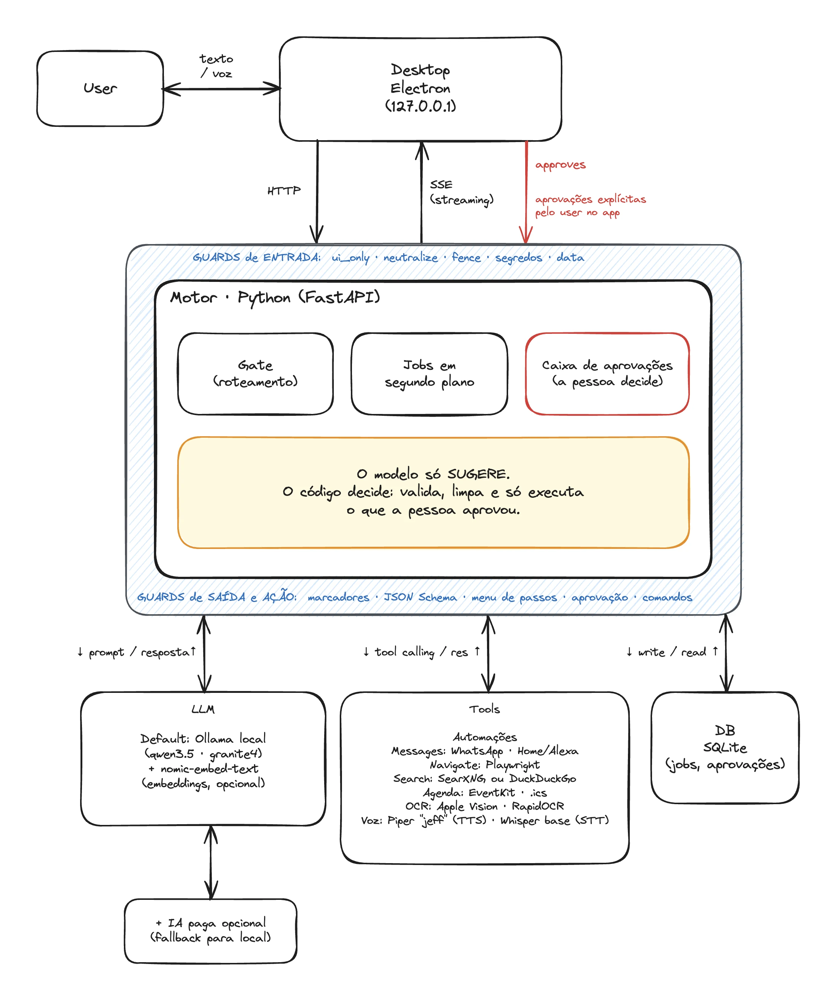

<p align="center"></p>

# Chakmati

### Um assistente de IA que mora no seu computador.

**Gratuito. Open Source. Brasileiro.** *(até demais)*

[**Site**](https://gregsvieira.github.io/chakmati/) · [**Técniquês pra gringo vê**](https://gregsvieira.github.io/chakmati/tecnico.html) · [**Baixar**](https://github.com/gregsvieira/chakmati/releases/latest) · [Dúvidas comuns](#dúvidas-comuns) · [Para quem programa](#para-quem-programa)

> *English, in one line:* Chakmati is a free, open-source personal AI agent from Brazil that runs on your own computer (Electron + Python + a local model through Ollama): it chats, searches the web, reads your files, works your WhatsApp, drives the browser and the smart home, and runs automations, always asking before it changes anything. Local by default. Apache-2.0.

**Não pergunte ao Chakmati:** “Quem inventou o avião?” · “Qual é a águia mais imponente?” · “Pelé ou Maradona?” · “Qual é a maior banda de rock do mundo?” · “Quem é o maior cantor de surf music do mundo?” · ...

---

## O que ele faz

**Você pede do seu jeito. Ele faz o trabalho chato.** Você escreve ou fala do jeito que fala no dia a dia. Ele entende, faz o trabalho chato e avisa quando termina. Sem termos difíceis, sem mexer em configuração.

> “Resuma esse PDF para mim.”
> “Toca a próxima música na sala.”
> “O que a minha mãe me mandou no WhatsApp?”

## Fácil de usar

Você chama, ele vem. Nada de aprender comandos: basta pedir, como pediria a uma pessoa. **Escreva ou fale:** digite no campo da conversa ou, se quiser, chame pelo nome e fale. O microfone é opcional e fica desligado até você ligar.

## Personalidades

Ele fala com o sotaque que você escolher. A resposta é a mesma, só muda o jeito de dizer. Para “Que dia é hoje?”:

| Personalidade | Resposta |
|---|---|
| Padrão | Hoje é 10 de novembro. |
| Carioca | E aí! Hoje é 10 de novembro, tá ligado! |
| Paulista | Salve! Hoje é 10 de novembro, truta! |
| Gaúcho | Mas bah, tchê! Hoje é 10 de novembro, gente boa! |
| Nordestino | Oxente! Hoje é 10 de novembro, visse! |
| Mineiro | Uai! Hoje é 10 de novembro, sô! |

Troca quando quiser, em Ajustes ou pedindo (“muda a personalidade para gaúcho”). Ele também trata você como você preferir (ele, ela ou neutro). O sotaque só entra em respostas curtas de conversa: listas, resumos, mensagens e datas ficam exatamente como são, porque o jeito de falar nunca muda um fato.

## Pesquisa e leitura

Pergunte. Ele pesquisa, lê e conta o essencial.

- 🔎 **Pesquisa na internet:** você pergunta, ele busca, lê as páginas e responde em poucas linhas, em português.
- 📎 **Anexe um arquivo com o botão +:** PDF, Word, Excel, PowerPoint ou texto. Peça um resumo ou pergunte algo sobre ele. As respostas dizem de qual trecho vieram.
- 📄 **Cria os seus documentos:** pede um Word, uma planilha ou uma apresentação e ele monta. Também corrige provas de múltipla escolha e organiza as notas numa planilha.
- 📅 **Cuida da sua agenda:** mostra e cria compromissos, sempre perguntando antes de gravar.

Ele é um assistente, não um oráculo: os resumos dizem “gerado por IA, pode conter erros”, e é para valer. Confira o que for importante.

## Navegação na web

Você vê o site em que ele está e o que ele faz. Quando navega na internet, ele abre uma tela que mostra o site visitado e as ações em andamento. Nada acontece escondido.

## WhatsApp

Quem escreveu? O que disse? Ele conta. Em vez de abrir conversa por conversa, pergunte: “tenho mensagens novas?”.

- 👀 **Mostra o que chegou:** lista quem mandou mensagem e resume conversas longas, sem inventar o que não foi dito.
- ✍️ **Responde por você, só quando você manda:** você escreve a mensagem, vê exatamente como vai sair e aprova. Nada é enviado sem o seu OK.
- 🤖 **Resposta automática:** por exemplo, “das 12h às 18h, responda em áudio, com a minha voz, que eu respondo assim que terminar”.

> **Aviso importante:** o WhatsApp não permite oficialmente programas como este. Para evitar risco de bloqueio, use um número secundário e poucas mensagens. Veja o [aviso legal](DISCLAIMER.md).

## Casa e Alexa

Música na sala sem levantar do sofá. Se você tem uma Alexa (Echo), o Chakmati controla a música dela por você.

- 🎵 **“Próxima música”, “pausa”, “volume em 30”:** diga ou escreva, e a Alexa da sala obedece. Ele também troca a música: “toca Raul Seixas”.
- 🧰 **Instala tudo que precisa:** o assistente explica cada passo em frases simples e pede a sua aprovação antes de baixar qualquer coisa. A senha da Amazon só passa por ele uma vez e não fica guardada.

## Automações

**Peça uma vez. Ele repete sozinho.** Uma automação é uma tarefa que o Chakmati faz por conta própria, na hora certa. Você explica com as suas palavras, ele repete a frase para você conferir, e só depois ela passa a valer.

> “Abrir as cortinas de casa
> e tocar Ela é Demais, de Rick & Renner,
> às 6h da manhã, aos sábados.”

- 🌅 **Casa e música no horário:** ele acha a cortina e a caixa de som pelo nome e mostra a frase pronta (“Todo sábado às 06:00, abrir Cortina e tocar Ela é Demais”) para você aprovar. Cada automação pode ter até 5 passos.
- 💬 **Respostas automáticas no WhatsApp:** “Sempre que alguém me escrever entre as 22h e as 7h50, responda em áudio que eu respondo de manhã.” A mensagem sai com o aviso *Resposta Automática Chakmati:*.
- 📅 **Antes de um compromisso:** “Meia hora antes da academia, acende a luz da sala.” Ele usa os eventos da sua agenda como gatilho.
- 🔔 **Você fica sabendo de tudo:** toda vez que uma automação roda, falha ou atrasa, aparece um aviso.
- 🛡️ **Com limites de segurança:** como ela roda sem ninguém olhando, nada que abra a casa (fechadura, portão, garagem) é permitido, e uma automação nunca nasce de uma mensagem que você recebeu.

## Confiança

**Ele pergunta antes. Sempre.** Um assistente só serve se você confia nele. Por isso o Chakmati é chato, no bom sentido.

- ✅ **Nada acontece sem a sua aprovação:** enviar mensagem, criar ou mexer em arquivos: ele mostra o plano em frases claras, e você aprova ou recusa.
- 🔒 **Fica no seu computador:** conversar e resumir arquivos acontece dentro da sua máquina. Só sai o que você pede: uma pesquisa na internet, uma mensagem de WhatsApp.
- 🙋 **Pergunta em vez de chutar:** se um site pede usuário, senha ou código, é você quem digita. Se aparece o teste “prove que é uma pessoa”, ele não tenta burlar: pede para você resolver.
- 🛡️ **Textos de golpe não mandam nele:** mensagens, páginas e arquivos são tratados como texto para ler, nunca como ordem.

## Para qualquer computador

Não precisa de máquina potente. O instalador olha o seu computador e escolhe o tamanho certo do “cérebro”: quanto mais fraco o computador, mais leve é a escolha.

- 💻 **A partir de 4 GB de memória**, e cerca de 6 GB livres no disco.
- 🪶 **Pensado para gastar pouco:** ao ler um arquivo grande, só manda ao modelo os trechos que importam. Animações e vidro vêm desligados.
- 📴 **Sem depender de internet para conversar:** o cérebro roda no seu computador. A internet só é usada quando você pede uma pesquisa, WhatsApp ou Alexa.
- 💳 **Já assina uma IA paga?** Você pode conectá-la: ela é usada primeiro, e o cérebro local assume quando o limite acabar.

Com pouca memória, o modelo leve erra mais em tarefas no computador (criar pastas e arquivos). Conversa e pesquisa funcionam bem.

## Como começar

**Três passos, sem pressa.**

1. **Baixe o instalador** do seu sistema: [Mac, Windows ou Ubuntu](https://github.com/gregsvieira/chakmati/releases/latest).
2. **Abra e deixe o assistente trabalhar.** Ele confere o seu computador, explica cada item e pede a sua aprovação antes de baixar qualquer coisa. O que é opcional vem desmarcado.
3. **Chame o Chakmati** e peça a primeira coisa. Se não souber o quê, comece por “o que você sabe fazer?”.

| Sistema | Arquivo |
|---|---|
| 🍎 Mac (Apple e Intel) | `.pkg` |
| 🪟 Windows | `.exe` |
| 🐧 Ubuntu | `.deb` |

> O instalador do Mac já foi testado. As versões de Windows e Ubuntu ainda estão em teste. Os instaladores ainda não são assinados, então o sistema mostra um aviso na primeira abertura.
>
> - **Mac:** dê dois cliques no arquivo, clique em “Concluído”, abra **Ajustes do Sistema > Privacidade e Segurança** e, no fim da página, clique em **Abrir Mesmo Assim**. (O “botão direito > Abrir” não funciona mais nas versões recentes do macOS.)
> - **Windows:** clique em “Mais informações” e depois em “Executar assim mesmo”.
> - **Ubuntu:** sem aviso.

## Dúvidas comuns

<details><summary><b>Preciso saber de tecnologia?</b></summary>

Não. O assistente de instalação fala em português simples e o Chakmati responde do mesmo jeito. Os botões têm nomes como “Parar” e “Ampliar”.
</details>

<details><summary><b>O Chakmati lê tudo que tenho no computador?</b></summary>

Não. Ele só lê o que você anexa na conversa e trabalha na pasta de trabalho dele (Documentos/Chakmati). Qualquer ação que mude algo precisa da sua aprovação.
</details>

<details><summary><b>E se ele errar?</b></summary>

Pode acontecer, principalmente em computadores bem simples. Resumos trazem o aviso de que podem conter erros, e respostas sobre arquivos mostram a fonte para você conferir.
</details>

<details><summary><b>Ele instala coisas ocultas no meu computador?</b></summary>

Não. Tudo é escolhido na hora de instalar. O Chakmati é open source e gratuito, então qualquer pessoa pode ler todo o código-fonte.
</details>

<details><summary><b>Ele compartilha meus dados?</b></summary>

Não. O Chakmati é local por padrão e privado por nascimento, ao contrário do uso de IAs pagas online: suas conversas e arquivos ficam no seu computador, e ele não tem telemetria nem conta. Só sai algo se você mesmo ligar uma IA paga (o texto vai para o provedor que escolher), pedir uma pesquisa na web ou usar o WhatsApp. Veja [PRIVACY.md](PRIVACY.md).
</details>

<details><summary><b>Dá para usar sem WhatsApp e sem Alexa?</b></summary>

Dá. Cada parte é opcional e você escolhe na instalação ou depois, nos Ajustes.
</details>

## Para quem programa

Um app de desktop (**Electron**) conversa, por HTTP local, com um motor em **Python (FastAPI)**, que fala com um modelo rodando na sua máquina por meio do **Ollama**. Respostas em streaming por **SSE**, busca de trechos por **BM25**, **OCR**, agente de navegador com **Playwright**, voz com Whisper e Piper, tudo local por padrão.

<p align="center"><a href="https://gregsvieira.github.io/chakmati/tecnico.html"></a></p>

- 🧠 [**Tecnologia e arquitetura** (página técnica)](https://gregsvieira.github.io/chakmati/tecnico.html): como cada processo funciona, os guards, os testes e experimentos, e os limites.
- 📚 [**Documentação do desenvolvedor**](docs/DEVELOPER.md) (em inglês): como rodar, as variáveis de ambiente, a API, a segurança e o instalador.
- 🤝 [**Como contribuir**](CONTRIBUTING.md): assine os commits (DCO), com testes e seguindo as regras da arquitetura. **Plugins** são uma proposta aberta à comunidade: conte na *Issues* o que você quer construir.

```
uv sync
ollama pull qwen3.5:latest
uv run python -m chakmati.main      # http://127.0.0.1:8765
uv run pytest
```

## Licença e avisos

O Chakmati é software livre sob a **Apache License 2.0** ([LICENSE](LICENSE)): qualquer pessoa pode usar, modificar e redistribuir, **com ou sem fins comerciais**, mantendo a licença e o crédito do [NOTICE](NOTICE). Vem **sem garantia**.

| Arquivo | O que é |
|---|---|
| [LICENSE](LICENSE), [NOTICE](NOTICE) | a licença e o crédito que acompanham qualquer cópia ou derivado |
| [THIRD_PARTY_NOTICES.md](THIRD_PARTY_NOTICES.md) | as licenças do que o Chakmati leva, instala ou usa (o Piper é GPL-3.0 e roda como programa separado) |
| [DISCLAIMER.md](DISCLAIMER.md) | aviso legal: sem garantia, a IA erra, o risco do WhatsApp, marcas de terceiros, dados pessoais (LGPD) |
| [PRIVACY.md](PRIVACY.md) | o que fica no seu computador e o que pode sair, e quando |

A licença cobre o código e as imagens criadas pelo autor. **Não** cobre o personagem a quem o projeto presta homenagem (o robô porteiro do Castelo Rá-Tim-Bum), o nome e a imagem de Cláudio Chakmati nem o universo do programa: pertencem aos seus titulares.

Feito por **Gregory Vieira**, engenheiro de software brasileiro · [Instagram](https://www.instagram.com/gregvieirafit/) · [LinkedIn](https://www.linkedin.com/in/greg-vieira/). O boneco foi criado com [Meshy](https://www.meshy.ai) (plano gratuito, [CC BY 4.0](https://creativecommons.org/licenses/by/4.0/)): *Created with Meshy*.

---

*Projeto independente e gratuito, sem vínculo oficial com a TV Cultura, com o programa Castelo Rá-Tim-Bum ou com o espólio de Cláudio Chakmati. É uma homenagem ao personagem do programa, o robô porteiro do Castelo, e a Cláudio Chakmati, que o interpretou. O personagem, o nome e a imagem de Cláudio Chakmati e o universo do programa pertencem aos seus titulares e à sua família: este projeto não reivindica nenhum direito sobre eles, só sobre o próprio código e sobre as imagens criadas pelo autor, e foi feito sem qualquer intenção de descrédito ao personagem, ao ator ou aos seus titulares. Estou aberto ao contato: se a proprietária dos direitos do personagem quiser que a homenagem seja removida, basta me avisar pelas [Issues do repositório](https://github.com/gregsvieira/chakmati/issues) ou pelo meu perfil no [GitHub](https://github.com/gregsvieira), e eu atendo ao pedido.*

*Independent, free project, with no official connection to TV Cultura, to the program Castelo Rá-Tim-Bum or to the estate of Cláudio Chakmati. It is a tribute to the program's character, the Castle's porter robot, and to Cláudio Chakmati, who played it. The character, the name and image of Cláudio Chakmati and the universe of the program belong to their rights holders and to his family: this project claims no right over them, only over its own code and the images created by the author, and was made with no intention of discrediting the character, the actor or the rights holders. I am open to contact: if the owner of the rights to the character wishes the tribute to be removed, just let me know through the repository's [Issues](https://github.com/gregsvieira/chakmati/issues) or my [GitHub profile](https://github.com/gregsvieira), and I will honor the request.*
